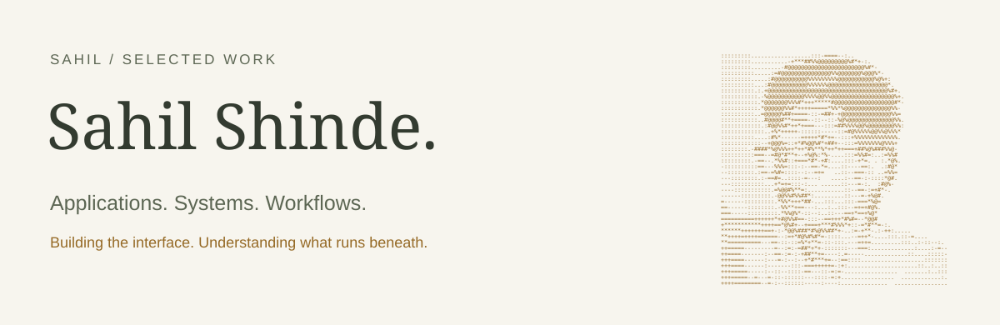
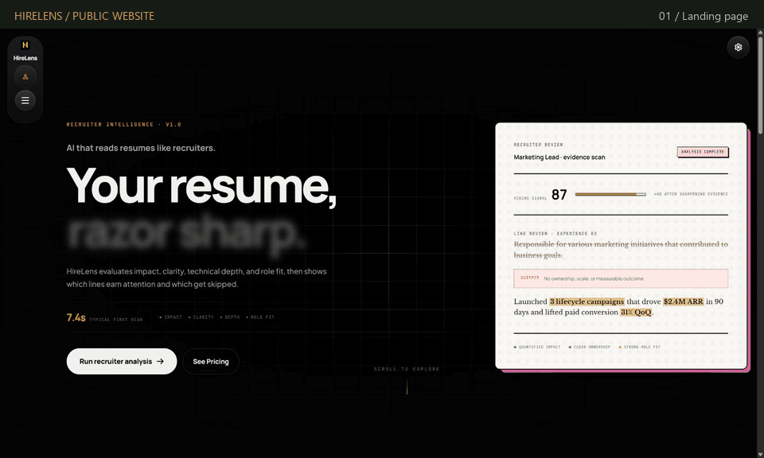
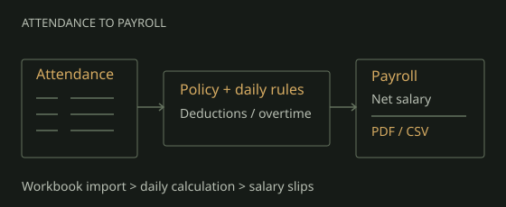
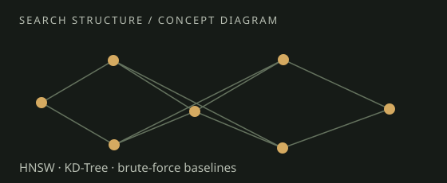
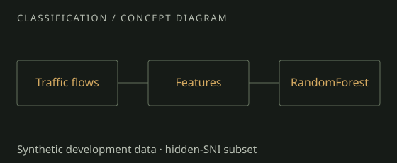
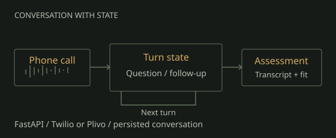
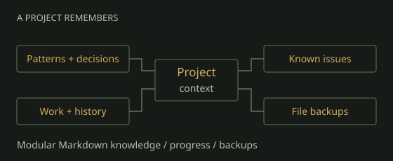
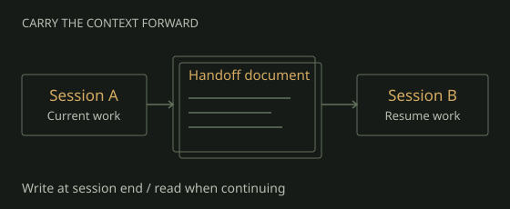
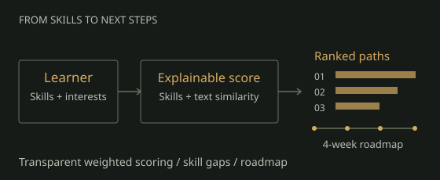

<picture>
  <source media="(prefers-color-scheme: dark) and (prefers-reduced-motion: reduce)" srcset="assets/nameplate-dark-static.svg">
  <source media="(prefers-reduced-motion: reduce)" srcset="assets/nameplate-light-static.svg">
  <source media="(prefers-color-scheme: dark)" srcset="assets/nameplate-dark.svg">
  
</picture>

My work moves between building applications people can use and understanding the systems beneath them.

<a href="https://www.linkedin.com/in/theshindesahil/"> LinkedIn</a> &nbsp; &#183; &nbsp; <a href="https://github.com/theshindesahil?tab=repositories"> All repositories</a>

 

## Featured application

<table width="100%"><tr><td colspan="2" width="100%" valign="top"><h3><a href="https://github.com/theshindesahil/hirelens-showcase"> HireLens</a></h3>
A resume intelligence application with analysis, rewriting, cover letters, and career workflows. React, FastAPI, and Supabase.

<a href="https://www.hirelens.online/"><picture><source media="(prefers-reduced-motion: reduce)" srcset="assets/hirelens-tour-poster.jpg"></picture></a>
</td></tr><tr><td width="50%" align="center">
<a href="https://www.hirelens.online/"> Live app</a>
</td><td width="50%" align="center">
<a href="https://github.com/theshindesahil/hirelens-showcase"> Showcase</a>
</td></tr></table>

 

## More of the work

<table width="100%"><tr><td width="50%" valign="top"><h3><a href="https://github.com/theshindesahil/Punch-Ledger"> PunchLedger</a></h3>
Attendance becomes payroll through explicit policy and daily calculations. An assignment implementation using fictional sample records.

<a href="https://punch-ledger.vercel.app/"> Sample app</a> &#183; <a href="https://github.com/theshindesahil/Punch-Ledger"> Source</a>
</td><td width="50%" valign="top"><h3><a href="https://github.com/theshindesahil/My-Own-AI"> VectorDB</a></h3>
Similarity search from the inside: HNSW, KD-Tree, brute-force baselines, persistence, and a local RAG workflow. Python and NumPy.

<a href="https://github.com/theshindesahil/My-Own-AI"> Implementation</a>
</td></tr><tr><td width="50%" valign="top"><h3><a href="https://github.com/theshindesahil/Deep-Packet-Inspection"> Deep Packet Inspection</a></h3>
An experiment comparing hostname matching with RandomForest classification on a synthetic dataset, including traffic with hidden SNI.

<a href="https://github.com/theshindesahil/Deep-Packet-Inspection"> Experiment</a> &#183; <a href="https://dpinspect.streamlit.app/"> Demo</a>
</td><td width="50%" valign="top"><h3><a href="https://github.com/theshindesahil/AI-Voice-Screening-Agent"> AI Voice Screening Agent</a></h3>
A project exploring voice-based candidate screening workflows.

</td></tr><tr><td width="50%" valign="top"><h3><a href="https://github.com/theshindesahil/project-memory-system"> Project Memory System</a></h3>
Preserve project context for continuity across working sessions.

</td><td width="50%" valign="top"><h3><a href="https://github.com/theshindesahil/session-handoff"> Session Handoff</a></h3>
Carry context from one session into the next.

</td></tr><tr><td width="50%"></td><td width="50%" valign="top"><h3><a href="https://github.com/theshindesahil/CareerCompass"> CareerCompass</a></h3>
Explore explainable career scoring and learning roadmaps.

</td></tr></table>

 

## Along the way

<picture>
  <source media="(prefers-color-scheme: dark)" srcset="https://theshindesahil.github.io/theshindesahil/assets/github-snake-dark.svg">
  <source media="(prefers-color-scheme: light)" srcset="https://theshindesahil.github.io/theshindesahil/assets/github-snake-light.svg">
  
</picture>

For engineering opportunities or a walkthrough of the work, find me on <a href="https://www.linkedin.com/in/theshindesahil/"> LinkedIn</a>.

<picture>
  <source media="(prefers-color-scheme: dark)" srcset="assets/footer-dark.svg">
  <source media="(prefers-color-scheme: light)" srcset="assets/footer-light.svg">
  
</picture>
