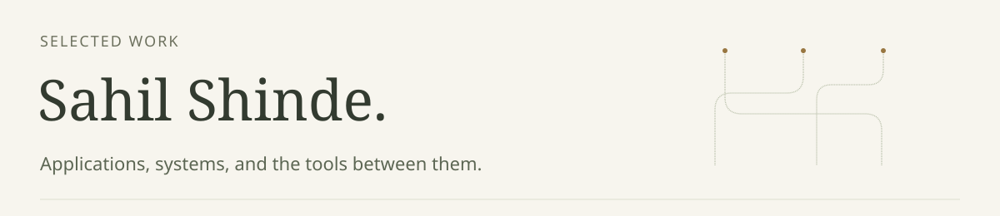
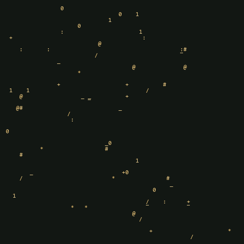
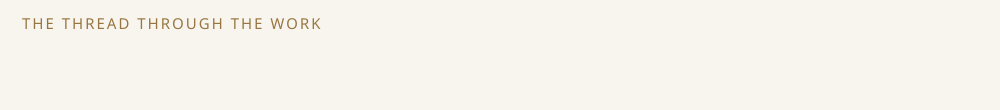
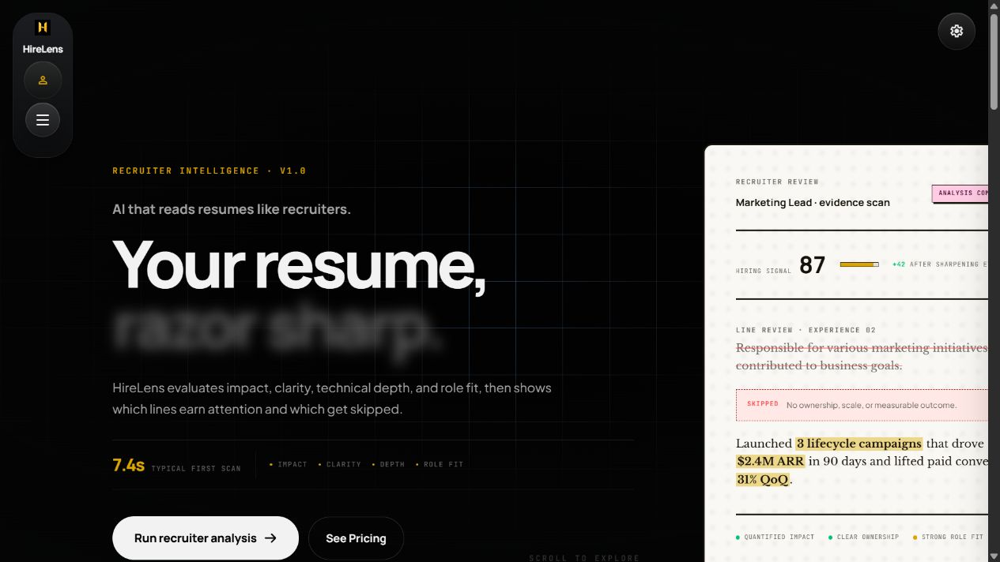
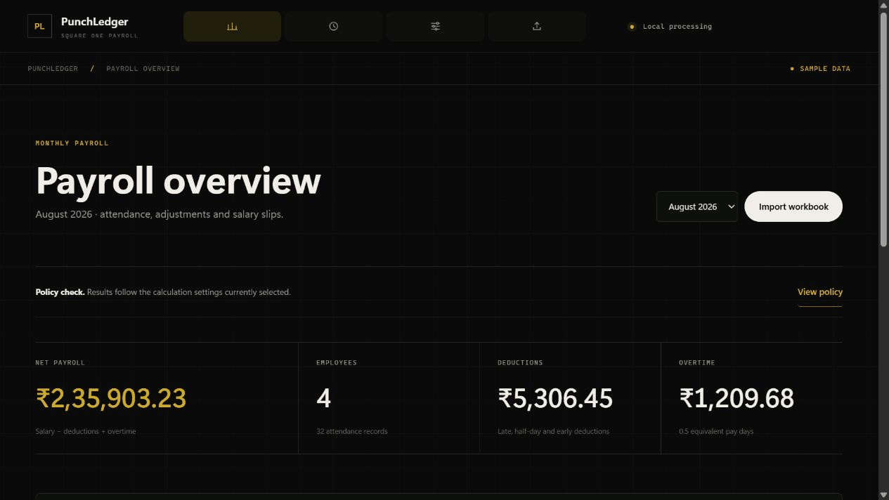

<picture>
  <source media="(prefers-color-scheme: dark)" srcset="assets/banner.svg">
  <source media="(prefers-color-scheme: light)" srcset="assets/banner-light.svg">
  
</picture>

<picture>
  <source media="(prefers-reduced-motion: reduce)" srcset="assets/ascii-avatar.png">
  
</picture>

My work moves between building an application people can use and understanding the systems beneath it. These projects show both sides.

<a href="https://www.linkedin.com/in/theshindesahil/"> LinkedIn</a> | <a href="https://github.com/theshindesahil?tab=repositories"> All repositories</a>

<picture>
  <source media="(prefers-color-scheme: dark)" srcset="assets/typing-dark.svg">
  <source media="(prefers-color-scheme: light)" srcset="assets/typing-light.svg">
  
</picture>

[Static ASCII portrait](assets/ascii-avatar.png)

## Start with the application

### <a href="https://github.com/theshindesahil/hirelens-showcase"> HireLens</a>

A resume intelligence application that brings analysis, improvements, cover letters, and career workflows into one interface. Built with React, FastAPI, and Supabase.

<a href="https://www.hirelens.online/"> Try HireLens</a> | <a href="https://github.com/theshindesahil/hirelens-showcase"> Read the public showcase</a>

## Look beneath the interface

### <a href="https://github.com/theshindesahil/My-Own-AI"> VectorDB</a>

What sits behind a similarity search? This project implements HNSW, KD-Tree, and brute-force search in Python and NumPy, with persistence, baseline comparisons, and a local RAG workflow.

### <a href="https://github.com/theshindesahil/Deep-Packet-Inspection"> Deep Packet Inspection</a>

What can a flow reveal when its hostname is hidden? This experiment compares hostname matching with RandomForest classification on a synthetic development dataset, including a hidden-SNI subset.

<a href="https://github.com/theshindesahil/Deep-Packet-Inspection"> Inspect the experiment</a> | <a href="https://dpinspect.streamlit.app/"> Open the demo</a>

## Bring the rules into a workflow

### <a href="https://github.com/theshindesahil/Punch-Ledger"> PunchLedger</a>

Attendance becomes payroll through explicit policy and daily calculations. This browser application imports workbooks, reviews breakdowns, and exports salary slips. An assignment implementation with documented assumptions and fictional sample records.

<a href="https://punch-ledger.vercel.app/"> Try the sample payroll</a> | <a href="https://github.com/theshindesahil/Punch-Ledger"> Read the implementation</a>

<a href="assets/punchledger-static.jpg"> Static screenshot</a>

The same interest in making a workflow understandable runs through my <a href="https://github.com/theshindesahil/AI-Voice-Screening-Agent"> AI Voice Screening Agent</a>, <a href="https://github.com/theshindesahil/session-handoff"> Session Handoff</a>, and <a href="https://github.com/theshindesahil/project-memory-system"> Project Memory System</a>. <a href="https://github.com/theshindesahil/CareerCompass"> CareerCompass</a> explores explainable career scoring and learning roadmaps.

## Tools behind the work

React and FastAPI for application workflows. Python and NumPy for search and classification experiments. Supabase for the resume application�s backend services.

## Along the way

<picture>
  <source media="(prefers-color-scheme: dark)" srcset="https://theshindesahil.github.io/theshindesahil/assets/github-snake-dark.svg">
  <source media="(prefers-color-scheme: light)" srcset="https://theshindesahil.github.io/theshindesahil/assets/github-snake-light.svg">
  
</picture>

About this little trail

Real public contribution levels captured on 11 October 2026. The amber snake consumes every active contribution day along an irregular generated route, then the board refills and the loop restarts. Each regeneration chooses a fresh route. GitHub README images cannot run JavaScript, so this is not live runtime randomness. After publication, GitHub Actions refreshes the public calendar daily and deploys only the artwork through GitHub Pages. No portfolio website or automated source commits are created. Scheduled runs may be delayed by GitHub. The checked-in image is a fallback snapshot; the theme-aware sources use the refreshed artwork.

<a href="assets/contributions-dark-static.svg"> Static calendar</a> | <a href="assets/banner-static.svg"> Static introduction</a>

For engineering opportunities or a walkthrough of the work, find me on <a href="https://www.linkedin.com/in/theshindesahil/"> LinkedIn</a>.

<picture>
  <source media="(prefers-color-scheme: dark)" srcset="assets/footer-dark.svg">
  <source media="(prefers-color-scheme: light)" srcset="assets/footer-light.svg">
  
</picture>
